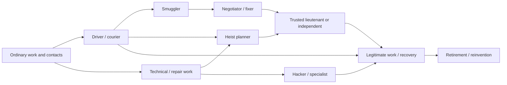

# Gotham: The Goon — Criminal Career Web

**Status: M013.1 design proposal, entirely unimplemented.** Current M013 has two
jobs, reputation, relationships, legal choices and faction competition, not these
careers or skills. The [bible](GOON_NARRATIVE_DESIGN_BIBLE.md) defines status labels.
No specialization, employer meeting, institution, or ending is promised by a save.

## A web of work, not classes

The player begins with ordinary experience, a contact and an obligation, not a
permanent class. A specialization describes work they have actually done and
qualifications others recognize. Several can coexist; legal work and recovery
remain available alongside an uneven criminal history. A driver can become a
planner without becoming a killer. Refusing violence cannot permanently disable
all advancement.

Proposed progression has four independent dimensions:

- **Capability:** bounded skills and learned approaches, usable in several jobs.
- **Proof:** references, completed obligations and witnessed decisions; reputation
  is attributed to an audience, not universal knowledge.
- **Commitment:** accepted contracts, personal code, debts, affiliations and
  promises. A label never replaces the actual terms.
- **Life situation:** freedom, housing/support, injury, recovery and legal status.
  Greater criminal rank may reduce safety or freedom rather than improve them.

Acquire qualifications through varied, finite milestones rather than repeating
the same crime for XP. Show prerequisites, alternatives, costs and known stakes.
Changing specialization preserves history; it does not erase victims, evidence,
friendships, or legal obligations. Employment, faction membership and personal
allegiance are separate. [Conditional opportunities](GOON_CONDITIONAL_OPPORTUNITIES.md)
govern whether work or a named employer is available at all.
The [minor ecosystem](GOON_MINOR_CRIMINAL_ECOSYSTEM.md) lets a specialization
support independent jobs, a small crew or a major employer. A trusted fixer can
remain influential without territory; promotion is responsibility, not automatic
faction registration. [Rogue registry roles](GOON_ROGUES_GALLERY_REGISTRY.md) are
conditional employers/associates/rivals rather than mandatory career bosses.
The [career geography](GOON_CAREER_GEOGRAPHY.md) connects these roles to the
[proposed city registry](GOON_LOCATION_REGISTRY.md). Physical place, territory,
work access and known contacts remain separate. New commute/location prerequisites
cannot be retroactively imposed on legacy jobs by loading an expanded atlas.

This illustrates possible transitions, not prerequisites or an exhaustive tree.
Informant work, incarceration, treatment and return to crime can intersect any
branch under their own eligibility and agency rules. Gang leadership is an
optional management responsibility, not a mandatory final rank.

Joker-affiliated street work is one possible contract context, not a separate
class or automatic membership. The [campaign recruitment proposal](GOON_JOKER_RECRUITMENT.md)
requires a direct Joker encounter during an Arkham storyline plus a valid offer
and explicit acceptance for formal initiation. A driver can work beside a cell,
keep a goon's friendship, decline initiation and finish a different career. No
arrest, psychiatric admission, repeated shift quota or guaranteed villain meeting
is a prerequisite for ordinary advancement or a valid ending.

## Specialization proposals

Every entry supplies the same eight fields. Skills below are fictional game
capabilities, not instruction in criminal methods. Encounters concern decisions,
people and consequences. Trafficking, kidnapping, killing, fire and chemical harm
receive no procedural detail, recipes, exploit instructions or targeting advice.
Victims retain identities, support needs and consequences beyond the player's reward.
Employer names are illustrative, continuity-dependent candidates from the
[matrix](GOON_FACTION_EMPLOYER_MATRIX.md), never guaranteed contacts.

### Driver / Wheelman

- **Fantasy:** the reliable worker everyone needs to get home. **Skills:** vehicle
  handling, composure, navigation and judgment, resolved as abstract checks.
- **Encounters:** disputed pickup, injured passenger, unsafe employer deadline.
  **Risks/consequences:** injury, witnessed involvement, lost references or a protected passenger.
- **Employers:** independent crews, Penguin, Falcone. **Advancement:** trusted driver,
  transport coordinator, responsibility for coworkers' return.
- **Transitions:** smuggler, bodyguard, fixer, planner. **Exit:** licensed civilian
  transport or repair work; retain obligations and legal records.

### Thief / Burglar

- **Fantasy:** an observant specialist choosing what a commission is worth.
  **Skills:** perception, patience, appraisal and fictional access aptitude.
- **Encounters:** disputed ownership, unexpected resident, misleading commission.
  **Risks/consequences:** frightened victims, evidence, lost trust and restitution obligations.
- **Employers:** independent brokers, Penguin, Riddler. **Advancement:** specialist
  commissions, team responsibility and authenticated references.
- **Transitions:** planner, impersonator, legitimate appraiser. **Exit:** restoration,
  honest appraisal or restitution work; no instructions for entering real premises.

### Smuggler

- **Fantasy:** a logistics worker discovering whose interests a shipment serves.
  **Skills:** coordination, appraisal, negotiation and risk assessment.
- **Encounters:** questionable declared contents, missing wages, a request to stop work.
  **Risks/consequences:** seizure, legal scrutiny, civilian harm or abandoned dependents.
- **Employers:** Penguin, Falcone, independent trading crews. **Advancement:** scheduler
  or contract coordinator with responsibility for terms.
- **Transitions:** driver, dealer, fixer, legitimate logistics. **Exit:** lawful freight,
  disclosure or reparative work; no border-evasion or concealment procedures.

### Illicit-market Dealer

- **Fantasy:** a neighborhood broker choosing between livelihood and harmful demand.
  **Skills:** appraisal, communication, accounting and recognizing coercion.
- **Encounters:** misrepresented goods, a vulnerable buyer, a supplier's unpaid promise.
  **Risks/consequences:** harm, debt, exploitation, neighborhood distrust and investigations.
- **Employers:** independent markets, Penguin, Black Mask intermediaries.
  **Advancement:** accountable brokerage and negotiated supply obligations.
- **Transitions:** fixer, fraudster, legitimate vendor. **Exit:** lawful commerce,
  restitution and treatment/support where relevant; no drug preparation or sales instructions.

### Trafficker

- **Fantasy:** a culpability-centered storyline about an exploitative criminal network,
  not an efficiency challenge. **Skills:** coordination, discernment and negotiation.
- **Encounters:** discover coercion, face a survivor's testimony, refuse a harmful order.
  **Risks/consequences:** severe victim harm, durable legal exposure and broken relationships.
- **Employers:** a proposed exploitative intermediary network, never a canonical claim
  about a named employer. **Advancement:** more responsibility also means greater culpability.
- **Transitions:** logistics, fixer, informant. **Exit:** stop participation, support
  survivors through safe institutions, accept accountability and seek lawful work.
  Any depiction involving people centers victims and refusal, never procurement or transport methods.

### Impersonator

- **Fantasy:** a performer whose assumed role conflicts with real relationships.
  **Skills:** acting, observation, social judgment and composure.
- **Encounters:** a contact recognizes a contradiction, an innocent person is blamed,
  a client demands another deception. **Risks/consequences:** harmed trust, evidence and identity disputes.
- **Employers:** independent crews, Riddler, Penguin. **Advancement:** complex authored
  social roles with more people relying on the performance.
- **Transitions:** con artist, negotiator, legitimate performer. **Exit:** honest stage
  work, repair misrepresentations and take responsibility; no identity-document forgery guidance.

### Fraudster / Con Artist

- **Fantasy:** a persuasive worker confronting the human cost of a profitable lie.
  **Skills:** rhetoric, accounting literacy, appraisal and reading social cues.
- **Encounters:** victim confrontation, disputed promise, a coworker refuses complicity.
  **Risks/consequences:** financial harm, documentary evidence and loss of future credibility.
- **Employers:** independent intermediaries, Penguin, Falcone. **Advancement:** managing
  commitments and facing audits, rather than larger numerical scams.
- **Transitions:** impersonator, fixer, legitimate bookkeeper. **Exit:** truthful advisory
  work and restitution; no actionable scam templates or instructions for defeating checks.

### Assassin / Contract Killer

- **Fantasy:** a grave decision about accepting, refusing or abandoning a lethal contract.
  **Skills:** composure, observation and judgment represented abstractly.
- **Encounters:** discover a false allegation, a witness asks for mercy, an employer
  orders silence. **Risks/consequences:** irreversible death, bereavement, serious investigation and isolation.
- **Employers:** continuity-approved criminal contractors, potentially Black Mask.
  **Advancement:** access brings culpability and restrictive obligations, not celebrated kill counts.
- **Transitions:** bodyguard, fixer, informant. **Exit:** refuse further contracts,
  cooperate or accept legal consequences and seek reintegration. No killing techniques or target-selection instruction.

### Collector / Enforcer

- **Fantasy:** a worker caught between a collection order and a person's circumstances.
  **Skills:** negotiation, composure, mediation and physical confidence.
- **Encounters:** disputed debt, unfair demand, coworker covering a shortfall.
  **Risks/consequences:** intimidation witnesses, injuries, resentment or a negotiated promise.
- **Employers:** Black Mask, Penguin, Falcone. **Advancement:** supervisor responsible
  for subordinates and settlement terms.
- **Transitions:** bodyguard, fixer, lieutenant. **Exit:** lawful mediation or collections
  under legitimate rules; past intimidation remains in memories and records.

### Muscle / Bodyguard

- **Fantasy:** being trusted to protect someone, including against a bad employer order.
  **Skills:** awareness, endurance, restraint and teamwork.
- **Encounters:** protect a coworker, evacuate civilians, choose surrender over escalation.
  **Risks/consequences:** injury, competing loyalties and responsibility for avoidable harm.
- **Employers:** Bane, Penguin, independent crews. **Advancement:** trusted escort or
  future crew lead with explicit safety obligations.
- **Transitions:** driver, enforcer, fixer. **Exit:** lawful security or support work,
  with qualifications and recovery milestones rather than automatic clearance.

### Negotiator / Fixer

- **Fantasy:** the person called when two promises cannot both be kept. **Skills:**
  mediation, listening, judgment and maintaining accurate commitments.
- **Encounters:** wage dispute, conflicting favors, a civilian needing an exit.
  **Risks/consequences:** exposed confidences, broken guarantees and polarized loyalties.
- **Employers:** independent clients and any eligible employer. **Advancement:** trusted
  intermediary or independent practice with a reputation for specific commitments.
- **Transitions:** planner, lieutenant, informant, legitimate mediator. **Exit:** lawful
  coordination and negotiated disengagement; cannot erase another person's evidence.

### Kidnapper

- **Fantasy:** a harm-centered coercion storyline with refusal and release as real choices.
  **Skills:** judgment, social perception and negotiation, not abduction techniques.
- **Encounters:** a captive asserts their needs, an order is contested, a family seeks help.
  **Risks/consequences:** trauma, lasting family hostility, severe investigation and culpability.
- **Employers:** a proposed coercive crew or authored villain demand, subject to review.
  **Advancement:** increased complicity and leverage create liabilities, not a captive-profit ladder.
- **Transitions:** fixer, bodyguard, informant. **Exit:** facilitate safety and release,
  accept consequences and pursue rehabilitation; no capture, restraint or ransom methods.

### Volatile Criminal / Wildcard

- **Fantasy:** an unreliable improviser deciding whether to become dependable.
  **Skills:** improvisation, composure, adaptability and recognizing personal limits.
- **Encounters:** a plan changes, an employer invites recklessness, a friend sets a boundary.
  **Risks/consequences:** lost references, unexpected obligations and harmed trust.
- **Employers:** Joker intermediaries, independent crews. **Advancement:** earn trust
  through chosen reliability or accept increasingly precarious offers.
- **Transitions:** performer, enforcer, fixer, civilian work. **Exit:** dependable routines
  and support; this is a work-history label, never a diagnosis or a mental-illness class.

### Smash-and-Grab Specialist

- **Fantasy:** a worker deciding whether a rushed order justifies disruption and harm.
  **Skills:** teamwork, appraisal, timing judgment and restraint, abstractly resolved.
- **Encounters:** a civilian remains present, a coworker wants to stop, ownership is disputed.
  **Risks/consequences:** injury, damaged livelihoods, witnesses and expensive restitution.
- **Employers:** independent crews, Black Mask intermediaries. **Advancement:** team
  coordinator accountable for outcomes, not faster repetitive destruction.
- **Transitions:** thief, driver, planner. **Exit:** salvage, repair and lawful logistics;
  no entry, tool-use or getaway procedures.

### Arsonist

- **Fantasy:** an authored crisis about refusing destruction or confronting its aftermath.
  **Skills:** hazard recognition, judgment and fictional scene assessment.
- **Encounters:** discover residents, protect a coworker, face survivors after an order.
  **Risks/consequences:** deaths, lost homes, persistent district damage and serious investigation.
- **Employers:** a reviewed destructive criminal commission, not an automatic named meeting.
  **Advancement:** authority brings responsibility for evacuation and refusal, not a fire score.
- **Transitions:** fixer, demolition specialist, legitimate restoration. **Exit:** repair,
  survivor support and accountability; no ignition, accelerant or fire-spread instructions.

### Heist Planner

- **Fantasy:** making promises to a crew while deciding what a job must not cost.
  **Skills:** coordination, budgeting, leadership and evaluating incomplete information.
- **Encounters:** conflicting roles, unreliable brief, crew member withdraws consent.
  **Risks/consequences:** failed obligations, injuries, unpaid shares and legal exposure.
- **Employers:** independent crews, Penguin, Falcone, Riddler. **Advancement:** trusted
  coordinator, lieutenant or independent organizer.
- **Transitions:** fixer, specialist, gang leader. **Exit:** legitimate project management,
  protect crew relationships and settle obligations; no real target or security planning.

### Hacker / Technologist

- **Fantasy:** a specialist deciding who should control sensitive information.
  **Skills:** fictional systems aptitude, repair, analysis and ethical judgment.
- **Encounters:** an employer misstates authorization, private data implicates a friend,
  a system needs safe restoration. **Risks/consequences:** privacy harm, evidence and professional distrust.
- **Employers:** Riddler, independent crews, legitimate repair clients. **Advancement:**
  technical lead with access controls and responsibility for other workers' contributions.
- **Transitions:** planner, fixer, lawful technician. **Exit:** authorized repair or defense
  work; no real exploit chains, credential theft or intrusion instructions.

### Demolition Specialist

- **Fantasy:** a specialist who can refuse an unsafe commission and answer for damage.
  **Skills:** hazard appraisal, planning discipline and fictional engineering aptitude.
- **Encounters:** structural risk report, evacuation dispute, misleading employer claim.
  **Risks/consequences:** injury, displacement, ruined infrastructure and investigation.
- **Employers:** reviewed industrial commissions, Bane, legitimate contractors.
  **Advancement:** safety coordinator or technical supervisor with explicit duties.
- **Transitions:** planner, repair specialist, fixer. **Exit:** lawful infrastructure work
  and restoration; no explosive materials, device construction or placement procedures.

### Chemical / Botanical Specialist

- **Fantasy:** technical competence tested by a demand that could harm others.
  **Skills:** fictional analysis, stewardship, hazard recognition and judgment.
- **Encounters:** uncertain exposure, a request for independent review, an unsafe experiment.
  **Risks/consequences:** injury, influence conditions, lost trust and documented harm.
- **Employers:** Poison Ivy, Scarecrow, Freeze or lawful research clients, if eligible.
  **Advancement:** trusted technician or ethical steward with refusal authority.
- **Transitions:** technologist, fixer, legitimate horticulture or support work.
  **Exit:** safe lawful employment and recovery; no toxin, drug or chemical recipes.

### Legitimate employment

- **Fantasy:** building an ordinary life whose success is worth protecting. **Skills:**
  repair, service, accounting, transport or care appropriate to the job.
- **Encounters:** scheduling conflicts, former employer pressure, a reference interview.
  **Risks/consequences:** lost wages or trust; honest work need not automatically invite punishment.
- **Employers:** original civilian businesses, cooperatives and public services.
  **Advancement:** secure role, training, responsibility and stable relationships.
- **Transitions:** overlaps every transferable skill; crime remains an optional temptation.
  **Exit:** retirement, self-employment or further education, with credible access despite setbacks.

### Informant work / Double agent

- **Fantasy:** deciding what to disclose, to whom, and whom a promise endangers.
  **Skills:** observation, judgment, communication and consistency.
- **Encounters:** allegation needing verification, conflict with a friend, request to stop.
  **Risks/consequences:** retaliation, legal obligations and specific trust loss.
- **Employers:** an eligible fictional investigator or reviewed rival contact; no automatic
  immunity. **Advancement:** more sensitive cooperation with clearer commitments.
- **Transitions:** fixer, legitimate work, reformed citizen. **Exit:** negotiated withdrawal
  and lawful support; no covert-tradecraft instructions or guaranteed hidden-identity system.

### Rehabilitation / Reinvention

- **Fantasy:** choosing improvement while remaining responsible for past harm.
  **Skills:** coping, communication, practical learning and keeping commitments.
- **Encounters:** voluntary support, reentry interview, accountability or relationship boundary.
  **Risks/consequences:** setbacks, stigma and conflicting obligations; treatment is not a punishment.
- **Employers/support:** ethical practitioners, educators, civilian employers and chosen peers.
  **Advancement:** specific recovery, education and employment milestones.
- **Transitions:** any lawful role, support for others or retirement. **Exit:** autonomous
  life with optional continuing care; never a mandatory cure or villain contact.

### Retirement / Independent closure

- **Fantasy:** leaving danger on chosen terms, rather than maximizing a power meter.
  **Skills:** planning, negotiation and sustaining ordinary commitments.
- **Encounters:** settle a promise, decline a final offer, choose who remains in contact.
  **Risks/consequences:** unresolved claims or damaged trust; disclose irreversible stakes.
- **Employers/support:** no required employer; trusted contacts or civilian work may help.
  **Advancement:** a stable life, personal freedom and relationships are valid achievements.
- **Transitions:** a concluded campaign, optional continuation, or explicit return to work.
  **Exit:** preserve the ending record; reopening cannot silently undo a final choice.

## Career outcomes and the ten review criteria

Specializations are not endings. Professional henchman, independent contractor,
lieutenant, gang leader, fugitive, incarcerated or institutionalized person,
reformed citizen, retired worker and tragic casualty describe different situations.
Incarceration and treatment can be playable chapters, not final labels. Ending
conditions consider freedom, safety, relationships, accountability and growth,
not just cash/territory. No employer encounter is required for campaign completion.

| Criterion | Career-web contract |
| --- | --- |
| Meaningful decisions | Select, combine, refuse or leave work; honor a personal code at a cost. |
| Observable consequences | Show accepted terms, actual settlement, audience-specific references and changed access. |
| Persistent state | Qualifications, contract history, promises, personal code commitments, evidence and chosen ending. |
| Alternative outcomes | Promotion, independent work, lost reference, lawful pivot, custody, recovery or retirement. |
| Replayability | Different obligations, contacts, demand and knowledge change which work is acceptable. |
| Grind risk | Repeated low-risk work could become the optimal qualification farm; use varied one-time proofs, not crime XP. |
| Determinism | Stable opportunity/contract IDs, sorted eligibility, pinned rules and exactly-once settlement; isolated seeded selection. |
| Save compatibility | A later version adds empty qualifications and unresolved goals without inventing a class or past crimes; old jobs/actions remain. |
| Offline operation | Local authored roles, terms, policies and self-contained progress. |
| Exploits and agency | No affiliation-switch reward loop, repeat reference farming, compulsory violence or reentry dead end; preserve useful refusal paths. |

This table applies to every role above. Individual encounters still need the
[ten-field feature review](GOON_GAMEPLAY_PRINCIPLES.md#the-ten-field-design-review)
and concrete migration/replay tests before implementation.

## Three worked divergent-career scenarios

All three are original **paper-only design walkthroughs**, not executable missions,
implemented medical/legal procedures, or adapted comic/video scenes. Each holds
the initial facts fixed; differing outcomes come from decisions. Proposed saved
facts below are conceptual fields, not changes to today's save schema.

### Scenario 1 — The last pickup

**Start:** a driver has one accepted pickup obligation, a civilian shift tomorrow,
and coworker Tess's trust. A commercial intermediary offers a better-paid extra
shift that conflicts with the agreed safe return of the crew. A Penguin introduction
is merely a possible future recommendation, not a reward guarantee.

| Choice | Immediate feedback | Persisted change | Later career divergence |
| --- | --- | --- | --- |
| Honor the crew pickup; refuse extra pay | Crew returns safely; bonus is declined | Kept promise, Tess trust, no extra wages | Reliable wheelman or bodyguard work; civilian reference remains possible |
| Take the extra shift after disclosing the conflict | Employer accepts; coworker declines future reliance | Paid contract, openly broken commitment, limited trust | Commercial logistics or independent contracting; no automatic villain meeting |
| Negotiate a willing substitute before acceptance | A named coworker accepts their own terms | Shared contract, paid share, reciprocal obligation | Fixer/planner work; coordination becomes an opportunity rather than a raw driving stat |

**Replay/grind:** change the substitute's availability or obligation, not just pay.
No repeated conversation generates trust or wages. **Determinism/save/offline:**
pin contract and participant IDs; settle each promise once; resume preserves the
choice and any invitation draw in local state. **Agency:** refusal leaves lawful
work available; one missed introduction never ends the campaign.

### Scenario 2 — The greenhouse favor

**Start:** a botanical support worker accepts a clearly risky fictional site visit
through an eligible intermediary. A documented exposure creates a persistent
influence condition and an offer advertised as relief. Cal can recommend an
independent ethical practitioner. Neither Ivy nor another villain must appear.

| Choice | Immediate feedback | Persisted change | Later career divergence |
| --- | --- | --- | --- |
| Leave and seek voluntary independent care | Missed fee; treatment options and confidentiality terms shown | Exposure source, chosen care, coping milestone, retained consent | Lawful horticulture, recovery or helping others; no mandatory arrest |
| Stay temporarily while asking Cal to maintain contact | Relief is uncertain; source and coercive pressure remain visible | Unresolved influence, trusted contact, review/exit plan | Compromised work with recurring decisions, not automatic allegiance or forced crimes |
| Request information from a dubious specialist | Credentials and conflicts can be questioned before commitment | Recorded referral and consent limits, or a rejected offer | An eligible Strange/Scarecrow episode may arise, or never occur; switching back to ethical care stays possible |

**Replay/grind:** source reliability and available support alter choices; repeatedly
seeking exposure cannot farm resistance or specialist meetings. **Determinism/save/
offline:** save exposure/offer IDs, one eligibility draw, scheduled review and chosen
care; no menu reroll or real-time symptom clock. **Agency:** the player can refuse
an exploitative practitioner and retain a zero-cash safety route. See the
[influence contract](GOON_VILLAIN_INFLUENCE_SYSTEM.md), not real treatment advice.

### Scenario 3 — A place after release

**Start:** a collector's documented case has produced a proposed custodial sentence
under the future fictional rules. At Blackgate a coworker offers a crew reference;
an educator offers training; an advocate can support a review. There is no psychiatric
commitment from conviction alone and no guaranteed named inmate encounter.

| Choice | Immediate feedback | Persisted change | Later career divergence |
| --- | --- | --- | --- |
| Take training and decline recruitment | Skills milestone and refusal acknowledged | Qualification, educator reference, lawful release/reentry plan | Civilian work, reform, eventual retirement; past record remains |
| Accept a crew's bounded favor | The actual promise and future obligation are shown | Personal debt and known affiliation, not universal loyalty | Enforcer or lieutenant opportunities after lawful release, with a meaningful refusal cost |
| Pursue review and voluntary counseling | Review date and separate consent terms displayed | Appeal result, chosen support, recovery milestones | Fixer or informant opportunities if eligible; no immunity or guaranteed early release |

**Replay/grind:** vary a cellmate's prior relationship, available training and
evidence; do not require repetitive prison chores. **Determinism/save/offline:**
persist the custody episode, review/release schedule and exactly-once milestones;
local save/resume cannot repeat a grant or release. **Agency:** finite episode
choices or explicit in-game advancement lead to a reviewed exit; poverty does not
force protection debt or villain treatment. The
[institution contract](GOON_INSTITUTIONS_AND_RECOVERY.md) defines the safeguards.
